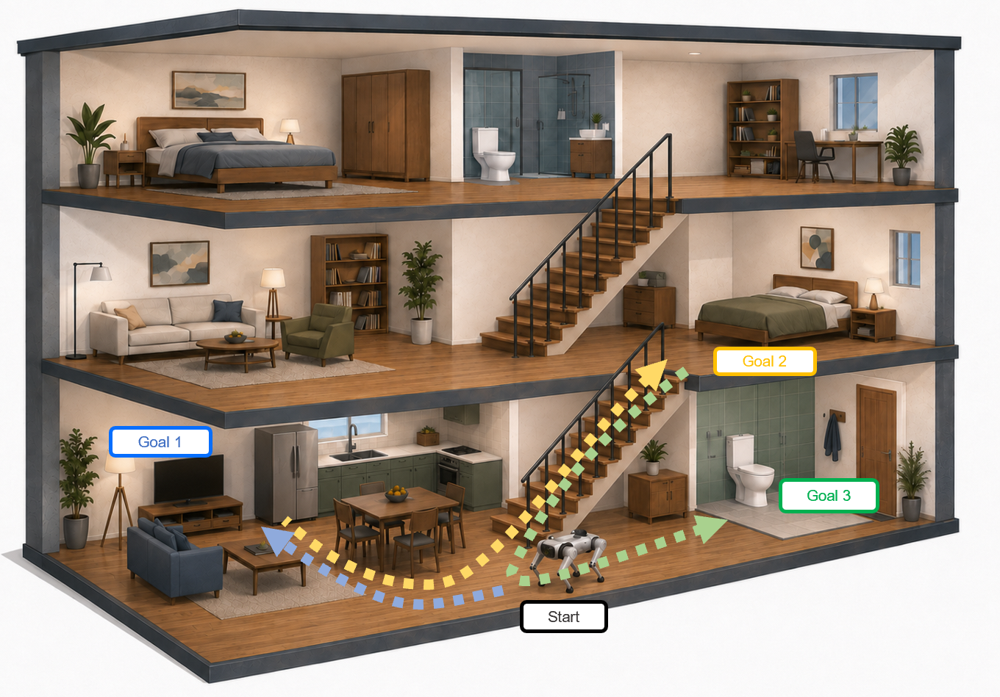
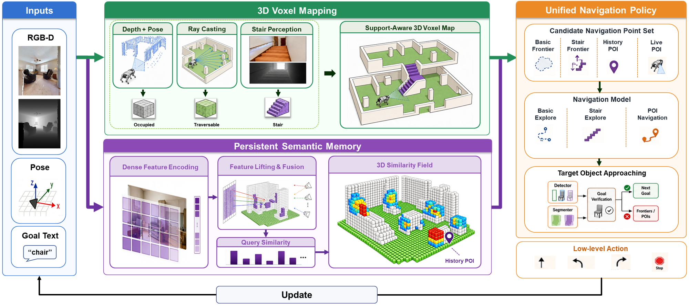

# LifelongCrossNav

**Persistent 3D Semantic Memory for Cross-Floor Multi-Goal Object Navigation**

<p align="center">
  <a href="https://arxiv.org/abs/2608.07079">Paper</a> |
  <a href="https://flageval-baai.github.io/LifelongCrossNavPage/">Project Page</a>
</p>

LifelongCrossNav is a navigation system for ordered multi-goal ObjectNav in
multi-floor indoor environments. It keeps one sparse 3D semantic-geometric
voxel memory across target queries, detects stairs with a dense segmentation
branch, and uses mode-aware 3D A* planning to connect exploration, stair
traversal, semantic retrieval, and object approach.

<p align="center">
  
</p>

## Overview

<p align="center">
  
</p>

## Tested environment


| Component | Tested value |
|---|---|
| OS | Ubuntu 22.04, Linux 6.8 |
| Python | 3.10.20 |
| PyTorch / torchvision | 2.11.0+cu128 / 0.26.0+cu128 |
| CUDA runtime used by PyTorch | 12.8 |
| GPU used for paper runs | NVIDIA GeForce RTX 5090, 32 GB |
| Habitat-Sim / Habitat-Lab | 0.2.4 / 0.2.4 |
| Transformers | 4.26.1 |
| OpenCV / NumPy | 4.8.0 / 1.26.4 |
| Detectron2 / timm | 0.6 / 1.0.26 |
| Rerun SDK | 0.23.1 |

The installed driver may expose a newer system CUDA version than the CUDA
runtime bundled with PyTorch; `torch.version.cuda` is the relevant value for
this environment.

## Setup

Clone the repository and create the test environment:

```bash
git clone <repository-url>
cd LifelongCrossNav

conda create -n lcn python=3.10 -y
conda activate lcn

python -m pip install torch torchvision torchaudio
python -m pip install gdown huggingface_hub

CMAKE_ARGS="-DCMAKE_POLICY_VERSION_MINIMUM=3.5" \
  python -m pip install \
  git+https://github.com/facebookresearch/habitat-sim.git@v0.2.4

python -m pip install -r requirements.txt
python -m pip install ./planning_cpp/
```

## Model Checkpoints

The Python packages needed to load these models are already listed in
`requirements.txt`; this section only downloads the checkpoint files. SHA-256
is a checksum that lets you verify the downloaded file matches the expected
content.

| Model | Source | Expected path | SHA-256 |
|---|---|---|---|
| SED dense encoder | gdown | `weights/clip.pth` | `6e9ab22fcecb0c0bbfa4eb63f29a287e79da49025951fa71ba854a6336b8e0fa` |
| D-FINE-X | wget | `weights/dfine_x_obj2coco.pth` | — |
| MobileSAM | wget | `weights/mobile_sam.pt` | `6dbb90523a35330fedd7f1d3dfc66f995213d81b29a5ca8108dbcdd4e37d6c2f` |
| SegFormer-B2 | Hugging Face download | `weights/segformer_b2_ade20k/` | `98cda441561de87673a89993fa5d68412c89d140892a43fbb6cd86cbc4885af3` |

```bash
mkdir -p weights/segformer_b2_ade20k

gdown 1D_RE4lvA-CiwrP75wsL8Iu1a6NrtrP9T -O weights/clip.pth

wget https://github.com/Peterande/storage/releases/download/dfinev1.0/dfine_x_obj2coco.pth \
  -O weights/dfine_x_obj2coco.pth
wget https://github.com/ChaoningZhang/MobileSAM/raw/refs/heads/master/weights/mobile_sam.pt \
  -O weights/mobile_sam.pt

huggingface-cli download nvidia/segformer-b2-finetuned-ade-512-512 \
  --local-dir weights/segformer_b2_ade20k \
  --local-dir-use-symlinks False
```

## Datasets


Create the datasets directory:
```
mkdir -p datasets
```

#### Download HM3D Scene Dataset
You can obtain access to Matterport for free [here](https://matterport.com/partners/meta). Once you have your credentials, download the HM3D scenes:

```
python3 -m habitat_sim.utils.datasets_download \
  --username <MATTERPORT_ID> --password <MATTERPORT_SECRET> \
  --uids hm3d_train_v0.2 \
  --data-path datasets

python3 -m habitat_sim.utils.datasets_download \
  --username <MATTERPORT_ID> --password <MATTERPORT_SECRET> \
  --uids hm3d_val_v0.2 \
  --data-path datasets
```

Create the `hm3d_v0.2` symlink if not already there:
```
ln -s datasets/scene_datasets/hm3d datasets/scene_datasets/hm3d_v0.2
```

#### Download Navigation Episode Datasets

Download ObjectNav HM3D v1 dataset:
```
wget https://dl.fbaipublicfiles.com/habitat/data/datasets/objectnav/hm3d/v1/objectnav_hm3d_v1.zip
unzip objectnav_hm3d_v1.zip
mv objectnav_hm3d_v1 datasets/
rm objectnav_hm3d_v1.zip
```
Download HM3D-MFMON dataset:
```
gdown "https://drive.google.com/uc?id=1mZOn_BVWHqdp4kYCygWvf9I-z0IEl3Lc" \
  -O objectnav_hm3d_MFMON.zip
unzip objectnav_hm3d_MFMON.zip
mv objectnav_hm3d_MFMON datasets/
rm objectnav_hm3d_MFMON.zip
```


Your `datasets/` directory should now contain:
```
datasets/
├── scene_datasets/
│   ├── hm3d/
│   └── hm3d_v0.2/
├── versioned_data/hm3d-0.2/hm3d/
├── objectnav_hm3d_v1/
└── objectnav_hm3d_MFMON/
```


## Evaluation

Run the commands below from the repository root after activating the environment.

Single episode visualization test:

Open another terminal on the host and start the Rerun viewer first:

```bash
rerun
```

Then run the episode script:

```bash
python eval_single_episode_3d.py \
  --episode_id 0 \
  --suffix rerun \
  --config config/mon/eval_multi_conf_floor.yaml \
  --rerun
```

Use `--rerun` for visualization. Omit it for a headless debug run.

Full multi-goal evaluation over all 927 episodes:

```bash
# worker 1
python eval_habitat_multi_3d.py \
  --config config/mon/eval_multi_conf_floor.yaml \
  --start 0 --limit 464 \
  --out_dir result_3d_full

# worker 2
python eval_habitat_multi_3d.py \
  --config config/mon/eval_multi_conf_floor.yaml \
  --start 464 --limit 463 \
  --out_dir result_3d_full
```

Single-target evaluation over all 2000 episodes:

```bash
python eval_habitat_3d.py \
  --config config/mon/eval_conf.yaml
```

Read the results with `read_results_multi_floor_3d.py`:

```bash
python read_results_multi_floor_3d.py \
  --type lcn \
  --out result_3d_full \
  --config config/mon/eval_multi_conf_floor.yaml \
  --metric_protocol posterior
```

`--type` selects the result format:

- `lcn` for LifelongCrossNav
- `onemap` for OneMap

`--metric_protocol` selects the metric protocol:

- `posterior` for multi-goal evaluation
- `onemap_v1` for single-target evaluation

Analyze the 288-episode cross-floor subset from the full evaluation results:

```bash
python analyze_multi_results_subsets.py \
  --csv result_3d_full/results.csv \
  --episode_ids_file config/mon/cross_floor_episode_ids.txt
```

## Acknowledgements

This project is built on top of the [OneMap](https://github.com/KTH-RPL/OneMap) codebase. We thank the OneMap team
for their open-source release.
